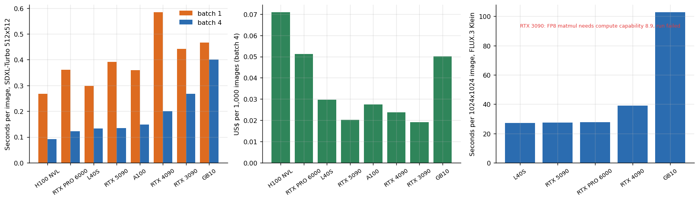
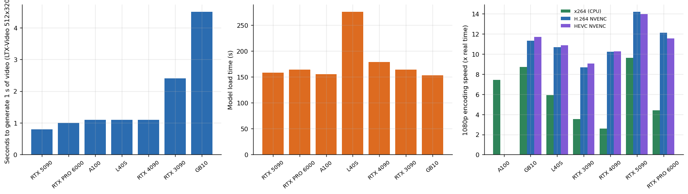

# Image and video generation bench

**What does one generated image, or one second of generated video, cost on a rented GPU, and what decides it?** SDXL-Turbo, FLUX.3 Klein, LTX-Video and FFmpeg hardware encoding on 8 GPU models, with the artifacts the runs produced.



## Why this matters

Generative media is priced per output, not per token, and the three things that decide the price are easy to miss when you only read a model card: **batching** (the same card can be 3x cheaper per image), **load time** (a video model can take minutes to load and seconds to generate, so the business model is a warm pool, not on-demand) and **hardware support** (a distilled image model failed outright on an Ampere card because its FP8 matmul needs compute capability 8.9).

## Artifacts produced by the runs

| SDXL-Turbo, batch 1 | SDXL-Turbo, batch 4 |
|---|---|
|  |  |

A 25-frame clip generated by LTX-Video (512x320, 25 steps): [`artifacts/ltx_25.mp4`](artifacts/ltx_25.mp4). These are the files the benchmark saved to prove the runs produced real output; no quality scoring was done. FLUX.3 Klein outputs are **not** redistributed (the model has its own terms).

## Headline results

| Finding | Evidence |
|---|---|
| SDXL-Turbo at batch 4 takes 0.09 s per image on the fastest card (H100 NVL) | `results/tables/sdxl_turbo_by_gpu.md` |
| Batching a batch of 4 makes each image 1.2 to 3.0 times cheaper | smallest gain on the ARM GB10 (1.2x), the largest on Blackwell and Ada cards |
| Cheapest SDXL-Turbo at batch 4 | **RTX 3090**, US$ 0.019 per 1,000 images |
| FLUX.3 Klein (1024x1024, 16 steps) | best 27 s per image on L40S; 103 s on the GB10; **failed on the RTX 3090** (FP8 matmul needs compute capability 8.9) |
| LTX-Video generates 1 s of video in 0.8 s on the best card (RTX 5090) | and in 4.5 s on the GB10 |
| But loading the model takes 153 to 276 s | about 163 times the generation time: a warm pool, not on-demand |
| NVENC against CPU x264 for 1080p H.264 | 1.3 to 4.0 times faster on the same machine. The x264 speed depends on the host CPU: 2.6x real time on the RTX 4090 host, 9.6x on the RTX 5090 host |



## Repository map

```
src/media/    libs.py (SDXL-Turbo, LTX-Video, FFmpeg timing functions), run_flux.sh (FLUX.3 Klein via the official CLI)
analysis/     image_gen.py, video_and_encoding.py
data/         libs_runs.csv, media_gated_runs.csv
artifacts/    the SDXL-Turbo images and the LTX-Video clip written by the runs
results/      figures and tables;  tests/  conclusions that must keep following from the data
```

## Reproduce

```bash
make setup && make all
python src/media/libs.py sdxl_turbo ltx_video ffmpeg      # on a CUDA machine with diffusers and ffmpeg
```

## Limits

One session per card, a handful of timed calls each. SDXL-Turbo timings are for 512x512 and 4 steps, so they say nothing about 1024x1024 SDXL. LTX-Video was timed at 512x320 only. Output quality, prompt adherence and safety filters are not evaluated. Hardware encoders differ in quality at equal bitrate; speed is all that was measured.

## Articles that use this repository

- [Image and video generation cost per output](https://www.kaggle.com/code/lucasrangelss/image-and-video-generation-cost-per-output)
- [What fits and what fails across seven GPUs](https://www.kaggle.com/code/lucasrangelss/what-fits-and-what-fails-across-seven-gpus)
- Related: [voice-stt-tts-bench](https://github.com/LucasRangelSSouza/voice-stt-tts-bench), [vast-gpu-benchmark-harness](https://github.com/LucasRangelSSouza/vast-gpu-benchmark-harness)

Licence: MIT for this code; SDXL-Turbo, LTX-Video and FLUX.3 Klein keep their own terms, see `LICENSE_NOTES.md`.
